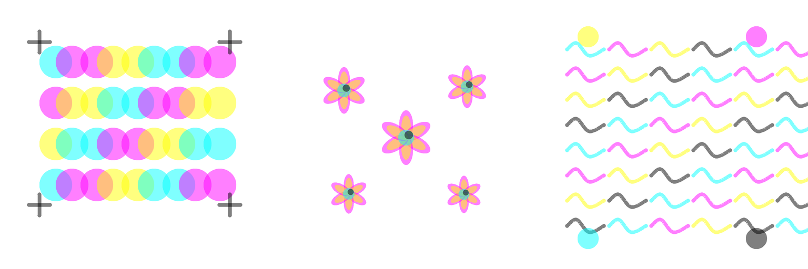

# Drawing Sandbox

A small tool for **assembling vector drawings, rendering them, and recording how they were built**. The visual style uses a deliberately narrow vocabulary: small cyan, magenta, yellow, and black marks overprinted on white.



## Run it

Use Python 3.10 or newer. In this folder:

```bash
python3 -m venv .venv
source .venv/bin/activate
python -m pip install -e .
python -m drawing_sandbox
```

Open **http://127.0.0.1:8766** if the browser does not open automatically. Rendering uses **NumPy and Pillow**; **Certifi** supplies the CA bundle for optional Crusoe inference calls. Rendering runs on the CPU, and model weights or local GPU setup are unnecessary.

Choose a starter drawing, add shapes, change object transforms, or edit its JSON. The editor offers undo and SVG, PNG, and JSON exports. Work stays in the current browser page; use the JSON download to keep a drawing before closing or reloading it.

## The environment contract

**Prompt → compose → render → record → revise.**

An agent such as Nemotron can propose typed changes to the same scene JSON that the editor uses. One renderer call returns an SVG, a PNG, and structured checks:

```python
from drawing_sandbox.server import render_drawing

result = render_drawing(scene)
# result["checks"]: valid, hard_checks, metrics, violations
# result["svg"] and result["png_data_url"] exist when the drawing is valid
```

The local renderer itself makes no model calls. `scripts/nemotron_iteration.py` is the explicit orchestration path: it sends the current PNG, reference image, and typed context to Crusoe Managed Inference, validates the returned proposal locally, and records the accepted revision.

The same operation is available over HTTP:

```text
POST http://127.0.0.1:8766/api/render
Content-Type: application/json

{"scene": {...}}
```

The server binds only to localhost. `GET /api/examples` returns the compliant starter scenes and the local Tahoe CMYK study. Optional request constraints can make a task stricter, but cannot relax the base instruction set.
`GET /api/instruction-set` returns the exact machine-readable policy agents should follow.

## Constrained instruction set

Agent-facing renders enforce these rules:

- The canvas background is white (`#ffffff`).
- Shape paint is limited to cyan (`#00ffff`), magenta (`#ff00ff`), yellow (`#ffff00`), and black (`#000000`).
- Every visible primitive has `opacity: 0.5`.
- A transformed primitive may span at most 96 canvas units.
- A transformed stroke may be at most 12 canvas units wide.
- Expanded scenes remain capped at 512 primitive shapes.

This makes color mixing, density, and form emerge through repeated small marks and source-over layering. Low-level structural utilities remain useful for inspecting older artifacts, while the HTTP API, `render_drawing`, and command-line render/check commands enforce the current policy.

## Drawing vocabulary

- **Path:** control points, stroke color, width; optional smoothing and fill.
- **Ellipse and polygon:** simple filled or outlined shapes.
- **Group:** move, rotate, and scale several shapes together.
- **Motif call:** use a manually defined reusable group with numeric arguments.

For example:

```json
{
  "version": 1,
  "canvas": {"width": 512, "height": 512, "background": "#ffffff"},
  "motifs": {},
  "nodes": [
    {"type": "ellipse", "cx": 240, "cy": 220, "rx": 30, "ry": 30,
     "fill": "#00ffff", "stroke": "none", "width": 0, "opacity": 0.5},
    {"type": "ellipse", "cx": 270, "cy": 220, "rx": 30, "ry": 30,
     "fill": "#ff00ff", "stroke": "none", "width": 0, "opacity": 0.5},
    {"type": "path", "points": [[220, 290], [250, 275], [290, 290]],
     "smooth": true, "stroke": "#000000", "width": 6,
     "fill": "none", "opacity": 0.5}
  ]
}
```

The checks cover finite coordinates, legal shapes and colors, motif arguments/references, cycles, geometry/expansion limits, the CMYK palette, opacity, and transformed mark size. They establish that a drawing follows the construction contract; visual meaning and attractiveness remain questions for the viewer or VLM. The renderer permits geometry outside the canvas and clips it.

## Recording progress and provenance

Use `POST /api/record` for every meaningful composition state. It accepts the same `scene` as `/api/render`, plus a stable run ID, the complete prompt set, a composition plan, and a step label:

```json
{
  "run_id": "lake-study-01",
  "prompt_set": ["Build a lake scene using layered CMYK marks."],
  "composition": {
    "layers": ["water marks", "mountain marks", "foreground accents"]
  },
  "step_label": "Water and distant ridge",
  "final": false,
  "scene": {}
}
```

Accepted states are appended under `recordings/<run_id>/steps/` as scene JSON, SVG, PNG, and checks. Send the accepted scene with `"final": true` to also save `final-scene.json`, `final-drawing.svg`, and `final-drawing.png`. `manifest.json` preserves the instruction set, prompts, composition plan, step labels, metrics, timestamps, and final-step pointer.

## Consecutive Nemotron-agent iteration

`drawing_sandbox/proto/agent_iteration.proto` defines the model-independent JSON/protobuf handoff between picture agents. The active runtime is Crusoe Managed Inference with `nvidia/Nemotron-3-Nano-Omni-Reasoning-30B-A3B`. The context carries that runtime identity, immutable prompts and composition intent, the current policy, stable layer/object IDs, artifact and reference paths, revision/hash guards, and accepted mutation history. Each Nemotron forward-inference call returns exactly one typed proposal:

- `split_layers`: replace one layer with an exhaustive, order-preserving partition.
- `combine_layers`: merge adjacent layers without changing their paint order.
- `add_objects`: insert uniquely identified renderer primitives into one layer.
- `remove_objects`: remove existing stable object IDs.

Agents never return a rewritten scene. `drawing_sandbox.iteration_context` applies one proposal atomically, materializes ordinary renderer JSON, checks the mandatory CMYK policy, records the render and provenance, and emits the next revision only on success. Stale revisions, duplicate IDs, illegal colors/opacities, oversized marks, invalid partitions, and non-adjacent combines are rejected without changing the prior context.

The inference CLI prefers `CRUSOE_API_TOKEN` and also accepts `CRUSOE_API_KEY` or `API_TOKEN`, either from the process environment or the repository's gitignored `.env` file. A bare token in `.env` is supported for compatibility. It records the exact text prompts, image asset paths, raw model response, response ID, token usage, parsed proposal, and validation attempts without recording the API key or base64 image payloads.

Run the standard four-agent Tahoe chain:

```bash
python scripts/nemotron_iteration.py run \
  --scene examples/26-tahoe-cmyk/scene.json \
  --source-manifest recordings/tahoe-cmyk-remake/manifest.json \
  --reference examples/26-tahoe-day/reference.jpg \
  --run-id tahoe-nemotron-chain-01
```

The default agent order is `split_layers`, `add_objects`, `remove_objects`, then `combine_layers`. Repeat `--skill <name>` to choose another sequence. `scripts/agent_iteration.py` remains available for offline initialization and manual application of already-produced typed proposals.

For a live read-only view of a recorded chain, open:

```text
http://127.0.0.1:8766/watch?run=tahoe-nemotron-chain-01
```

The viewer auto-plays recorded revisions, polls locally for newly accepted frames, and exposes only playback controls. `GET /api/watch?run=<run-id>` supplies revision metadata and `GET /api/watch/frame?run=<run-id>&step=<index>` supplies immutable PNG frames. `scripts/make_agent_timelapse.py` exports the same history as a labeled MP4 and GIF.

## Terminal use

```bash
python -m drawing_sandbox examples --out examples
python -m drawing_sandbox render examples/cmyk-overprint/scene.json --out output
python -m drawing_sandbox check examples/cmyk-overprint/scene.json
python -m unittest discover -s tests -v
python -m drawing_sandbox.evals suite evals/smoke.json   # provisional evals, see EVALS.md
```

SVG, PNG, and JSON starter files are included under `examples/`. They are authored illustrations, ready to edit. The reusable motifs in them are predefined drawing parts.

The earlier Tahoe study is preserved under `examples/26-tahoe-day/` with its source `reference.jpg`, vector scene, rendered PNG/SVG, and construction timelapse. It predates the CMYK policy, so it is reference material rather than an accepted input to the current agent-facing renderer.

The constrained remake lives under `examples/26-tahoe-cmyk/`. It uses 447 legal CMYK marks and includes its final scene, PNG/SVG, and construction timelapse. Its complete prompt set, composition plan, six accepted progress frames, checks, and final artifacts are recorded under `recordings/tahoe-cmyk-remake/`.

The live Managed Inference exercise is recorded under `recordings/tahoe-nemotron-chain-01/`. Four consecutive Nemotron Omni Nano calls performed `split_layers`, `add_objects`, `remove_objects`, and `combine_layers`; every call has a prompt/response/usage log under `handoffs/inference-*.json`, and the accepted five-frame replay is exported as MP4 and GIF. The earlier `tahoe-luna-chain-01` directory is retained only as historical output from the pre-Managed-Inference prototype.

## Later domains

Keep the same outer interaction—submit a construction, render it, return checks. A graph domain can add node/edge construction and graph predicates. A small 3D domain can add primitive objects, a fixed orthographic camera, and geometric checks. Those implementations are future work; the first environment stays small.

The 3D concern is manageable by constraining the scene and render budget: a few primitives and one low-resolution view is a sensible first target. Benchmark an actual renderer on your Mac before adding multi-view search or more elaborate lighting.
