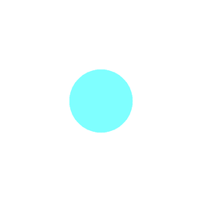
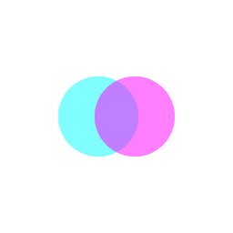
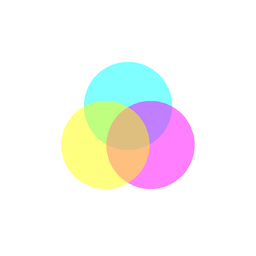
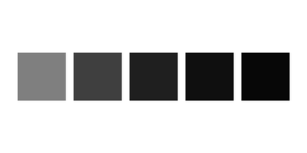
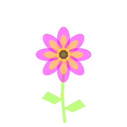
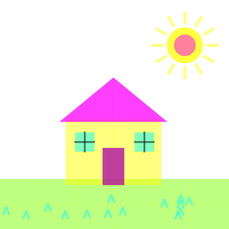
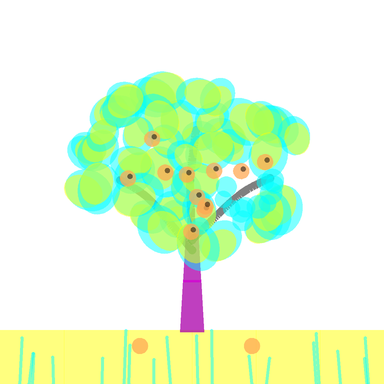
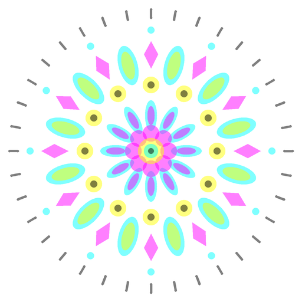
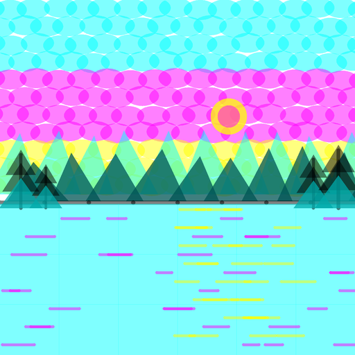
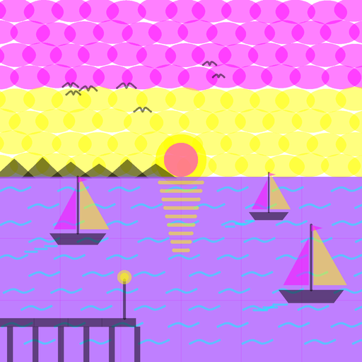

# Drawing task dataset

10 drawing tasks, easiest first. Every task must follow the CMYK rules (white canvas, cyan/magenta/yellow/black only, 50% opacity, marks at most 96 units across, at most 512 marks), plus any extra constraints listed for it.

Give an agent `task.json` (or a line of `tasks.jsonl`). Score its drawing with the renderer's checks for the hard rules and the success criteria for the rest. `reference/` holds one passing solution for comparison, not the only right answer.

Regenerate with `python -m drawing_sandbox dataset --out dataset`.

| Level | Task | Tier | Extra limits | Reference marks | Reference |
| --- | --- | --- | --- | --- | --- |
| 1 | [Single dot](01-single-dot/task.json) | beginner | max_shapes 1 | 1 |  |
| 2 | [Two-ink overprint](02-two-ink-overprint/task.json) | beginner | max_shapes 2 | 2 |  |
| 3 | [Three-ink Venn](03-three-ink-venn/task.json) | beginner | max_shapes 3 | 3 |  |
| 4 | [Tonal ramp](04-tonal-ramp/task.json) | intermediate | max_shapes 20 | 15 |  |
| 5 | [Flower](05-flower/task.json) | intermediate | max_shapes 40 | 26 |  |
| 6 | [Sunny house](06-sunny-house/task.json) | intermediate | max_shapes 120 | 69 |  |
| 7 | [Fruit tree](07-fruit-tree/task.json) | advanced | max_shapes 220 | 175 |  |
| 8 | [Twelve-fold mandala](08-mandala/task.json) | advanced | max_shapes 200 | 143 |  |
| 9 | [Mountain lake at dusk](09-mountain-lake/task.json) | expert | none | 325 |  |
| 10 | [Harbor at sunset](10-harbor-sunset/task.json) | expert | none | 280 |  |

## 1. Single dot

> Draw one cyan circle in the center of the canvas.

Skills: place one primitive, use the required opacity

Success criteria:
- Exactly one cyan circle
- It sits roughly in the middle of the canvas

## 2. Two-ink overprint

> Overlap a cyan circle and a magenta circle so that a blue-violet lens appears where they cross.

Skills: layering, subtractive mixing of two inks

Success criteria:
- Two circles, one cyan and one magenta
- A visible darker overlap region between them

## 3. Three-ink Venn

> Make a three-circle Venn diagram in cyan, magenta and yellow so that green, red, blue and a dark center all appear.

Skills: three-way overprint, symmetric placement

Success criteria:
- Three circles, one per CMY ink
- Pairwise overlaps show green, red and blue
- A darker region where all three meet
- Roughly triangular, balanced arrangement

## 4. Tonal ramp

> Make a row of five equal squares that go from light grey to near-black, using only black at 50% opacity.

Skills: building value by stacking identical marks, even spacing

Success criteria:
- Five squares of equal size in a row
- Each square is darker than the one before
- Only black ink is used

## 5. Flower

> Draw a single flower with eight petals, a dark center, a green stem and two leaves.

Skills: defining and reusing a motif, rotation, mixing green from cyan and yellow

Success criteria:
- Eight evenly rotated petals
- A distinct center
- A stem below the bloom
- Two leaves on the stem, reading as green

## 6. Sunny house

> Draw a simple house on green grass under a sun: walls, pitched roof, a door, two windows, and a sun with rays.

Skills: composing several objects, tiling large areas under the 96-unit span limit, spatial layout

Success criteria:
- Recognizable house with roof, door and two windows
- Grass along the bottom
- Sun with rays in the sky
- Objects do not awkwardly overlap

## 7. Fruit tree

> Draw a fruit tree: a trunk with branches, a full leafy canopy built from many small clusters, red fruit in the canopy and two fallen fruit on the ground.

Skills: organic texture from many small marks, random but controlled placement, light and shadow

Success criteria:
- Trunk and visible branches
- Canopy reads as a mass of leaves, not one blob
- Shadowed side of the canopy is darker
- Red fruit inside the canopy and on the ground

## 8. Twelve-fold mandala

> Design a mandala with exact twelve-fold rotational symmetry: an inner ring, a ring of petals, a ring of spokes with ornaments, and a fine outer ring of ticks.

Skills: exact rotational symmetry, multiple motifs, nested rings

Success criteria:
- Twelve-fold symmetry holds for every ring
- At least four distinct concentric rings
- Centerd on the canvas
- Uses all four inks deliberately

## 9. Mountain lake at dusk

> Paint a mountain lake at dusk: a sky graded from blue at the top to warm at the horizon, a low sun, two mountain ranges for depth, a lake that reflects the sunset, and pine trees in the foreground.

Skills: color gradients from small marks, atmospheric depth, reflections, working near the 512-mark budget

Success criteria:
- Sky gradient from cool to warm without visible gaps
- Far range lighter than near range
- Lake reflects sunset colors
- Foreground pines frame the scene
- Clear horizon line

## 10. Harbor at sunset

> Paint a harbor at sunset: warm sky, setting sun with a reflection on the water, a dark headland, three sailboats at different distances with wakes, a wooden pier with a lit lamp, and gulls overhead.

Skills: many interacting objects, scale for distance, reflections, narrative composition, budgeting marks across the whole image

Success criteria:
- Sun with a vertical reflection on the water
- Three sailboats of different sizes suggesting depth
- Each boat has hull, mast and sails
- Pier with posts and a lit lamp
- Gulls in the sky
- Sea shows wave texture
- Composition is balanced, not cluttered
