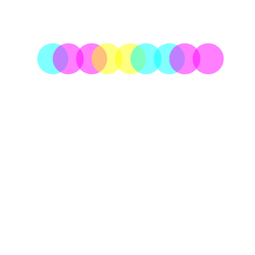
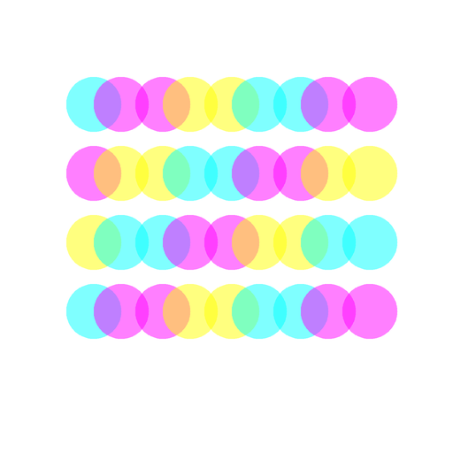
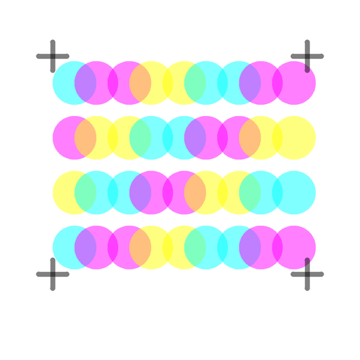

# Run: cmyk-overprint-demo

Started 2026-10-17T18:41:40.448145+00:00, last updated 2026-10-17T18:41:40.593363+00:00.
3 steps recorded; step 3 is the accepted final.

## Prompts

1. Create a composition using only small cyan, magenta, yellow, and black marks at 50% opacity.
2. Explore subtractive color mixing through repeated circular overprints; finish with black registration marks.

## Plan

- **Title:** CMYK overprint
- **Layers:**
  - nodes 1–9: first overprint row
  - nodes 10–36: complete color field
  - nodes 37–44: black registration marks

## Step 1: First overprint row



```text
PASS: 10 of 10 rules passed
Stats: marks 9, inks used 3, widest mark 62, thickest stroke 0
```

**What was drawn:**

```text
Canvas: 512×512, background white
Marks: 9 total (9 ellipse)
Ink use: magenta 4, cyan 3, yellow 2
Top-level nodes (9), in paint order:
    1. ellipse at (106, 118), radius 31, cyan fill
    2. ellipse at (137, 118), radius 31, magenta fill
    3. ellipse at (184, 118), radius 31, magenta fill
    4. ellipse at (215, 118), radius 31, yellow fill
    5. ellipse at (262, 118), radius 31, yellow fill
    6. ellipse at (293, 118), radius 31, cyan fill
    7. ellipse at (340, 118), radius 31, cyan fill
    8. ellipse at (371, 118), radius 31, magenta fill
    9. ellipse at (418, 118), radius 31, magenta fill
```

Files: [scene](steps/000-scene.json) · [svg](steps/000-drawing.svg) · [checks](steps/000-checks.json)

## Step 2: Complete color field



```text
PASS: 10 of 10 rules passed
Stats: marks 36, inks used 3, widest mark 62, thickest stroke 0
```

**What was drawn:**

```text
Canvas: 512×512, background white
Marks: 36 total (36 ellipse)
Ink use: magenta 13, cyan 12, yellow 11
Top-level nodes (36), in paint order:
    1. ellipse at (106, 118), radius 31, cyan fill
    2. ellipse at (137, 118), radius 31, magenta fill
    3. ellipse at (184, 118), radius 31, magenta fill
    4. ellipse at (215, 118), radius 31, yellow fill
    5. ellipse at (262, 118), radius 31, yellow fill
    6. ellipse at (293, 118), radius 31, cyan fill
    7. ellipse at (340, 118), radius 31, cyan fill
    8. ellipse at (371, 118), radius 31, magenta fill
    9. ellipse at (418, 118), radius 31, magenta fill
   10. ellipse at (106, 196), radius 31, magenta fill
   11. ellipse at (137, 196), radius 31, yellow fill
   12. ellipse at (184, 196), radius 31, yellow fill
   13. ellipse at (215, 196), radius 31, cyan fill
   14. ellipse at (262, 196), radius 31, cyan fill
   15. ellipse at (293, 196), radius 31, magenta fill
   16. ellipse at (340, 196), radius 31, magenta fill
   17. ellipse at (371, 196), radius 31, yellow fill
   18. ellipse at (418, 196), radius 31, yellow fill
   19. ellipse at (106, 274), radius 31, yellow fill
   20. ellipse at (137, 274), radius 31, cyan fill
   21. ellipse at (184, 274), radius 31, cyan fill
   22. ellipse at (215, 274), radius 31, magenta fill
   23. ellipse at (262, 274), radius 31, magenta fill
   24. ellipse at (293, 274), radius 31, yellow fill
   25. ellipse at (340, 274), radius 31, yellow fill
   26. ellipse at (371, 274), radius 31, cyan fill
   27. ellipse at (418, 274), radius 31, cyan fill
   28. ellipse at (106, 352), radius 31, cyan fill
   29. ellipse at (137, 352), radius 31, magenta fill
   30. ellipse at (184, 352), radius 31, magenta fill
   31. ellipse at (215, 352), radius 31, yellow fill
   32. ellipse at (262, 352), radius 31, yellow fill
   33. ellipse at (293, 352), radius 31, cyan fill
   34. ellipse at (340, 352), radius 31, cyan fill
   35. ellipse at (371, 352), radius 31, magenta fill
   36. ellipse at (418, 352), radius 31, magenta fill
```

Files: [scene](steps/001-scene.json) · [svg](steps/001-drawing.svg) · [checks](steps/001-checks.json)

## Step 3: Registration marks and accepted final (final)



```text
PASS: 10 of 10 rules passed
Stats: marks 44, inks used 4, widest mark 62, thickest stroke 7
```

**What was drawn:**

```text
Canvas: 512×512, background white
Marks: 44 total (36 ellipse, 8 path)
Ink use: magenta 13, cyan 12, yellow 11, black 8
Top-level nodes (44), in paint order:
    1. ellipse at (106, 118), radius 31, cyan fill
    2. ellipse at (137, 118), radius 31, magenta fill
    3. ellipse at (184, 118), radius 31, magenta fill
    4. ellipse at (215, 118), radius 31, yellow fill
    5. ellipse at (262, 118), radius 31, yellow fill
    6. ellipse at (293, 118), radius 31, cyan fill
    7. ellipse at (340, 118), radius 31, cyan fill
    8. ellipse at (371, 118), radius 31, magenta fill
    9. ellipse at (418, 118), radius 31, magenta fill
   10. ellipse at (106, 196), radius 31, magenta fill
   11. ellipse at (137, 196), radius 31, yellow fill
   12. ellipse at (184, 196), radius 31, yellow fill
   13. ellipse at (215, 196), radius 31, cyan fill
   14. ellipse at (262, 196), radius 31, cyan fill
   15. ellipse at (293, 196), radius 31, magenta fill
   16. ellipse at (340, 196), radius 31, magenta fill
   17. ellipse at (371, 196), radius 31, yellow fill
   18. ellipse at (418, 196), radius 31, yellow fill
   19. ellipse at (106, 274), radius 31, yellow fill
   20. ellipse at (137, 274), radius 31, cyan fill
   21. ellipse at (184, 274), radius 31, cyan fill
   22. ellipse at (215, 274), radius 31, magenta fill
   23. ellipse at (262, 274), radius 31, magenta fill
   24. ellipse at (293, 274), radius 31, yellow fill
   25. ellipse at (340, 274), radius 31, yellow fill
   26. ellipse at (371, 274), radius 31, cyan fill
   27. ellipse at (418, 274), radius 31, cyan fill
   28. ellipse at (106, 352), radius 31, cyan fill
   29. ellipse at (137, 352), radius 31, magenta fill
   30. ellipse at (184, 352), radius 31, magenta fill
   31. ellipse at (215, 352), radius 31, yellow fill
   32. ellipse at (262, 352), radius 31, yellow fill
   33. ellipse at (293, 352), radius 31, cyan fill
   34. ellipse at (340, 352), radius 31, cyan fill
   35. ellipse at (371, 352), radius 31, magenta fill
   36. ellipse at (418, 352), radius 31, magenta fill
   37. path with 2 points from (55, 80), black stroke 7
   38. path with 2 points from (75, 60), black stroke 7
   39. path with 2 points from (417, 80), black stroke 7
   40. path with 2 points from (437, 60), black stroke 7
  ... and 4 more
```

Files: [scene](steps/002-scene.json) · [svg](steps/002-drawing.svg) · [checks](steps/002-checks.json)
